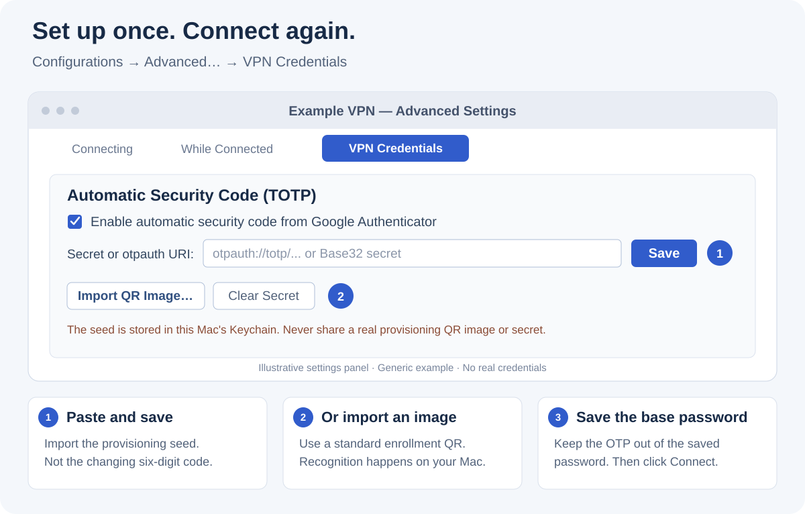

# Automatic TOTP: setup and troubleshooting

This guide covers the proposed optional automatic security-code feature for Tunnelblick's 8.x branch. The feature is available in this implementation branch, rather than existing official releases.

## Before setup

Your VPN must accept a password followed directly by a standard TOTP code: six digits, HMAC-SHA1, and a 30-second period. Obtain the provisioning seed or its standard QR image through your account's supported enrollment flow. A changing six-digit code is not a seed.

An `otpauth://totp/...` URI or a plain Base32 seed can be imported as text. A QR image must contain that supported provisioning payload. Google Authenticator's multi-account transfer format (`otpauth-migration://`) is not supported. The importer only extracts the seed; it does not configure the algorithm, period, or number of digits from URI parameters.

## Configure once

1. Build and install an application from this implementation branch using the upstream build instructions, then import your existing VPN profile if needed.
2. Open **VPN Details → Configurations → Advanced… → VPN Credentials** for the selected profile.
3. Paste the provisioning seed or URI and click **Save**, or choose **Import QR Image…**.
4. Confirm **Enable automatic security code from Google Authenticator** is checked. Saving or importing enables it automatically.
5. Connect and save the username and base password in Keychain. Store only the base password, without a code appended to it.
6. Reconnect. With saved credentials and a working automatic seed, the client generates and submits the current code without opening the login window.

The login window also offers **Configure automatic security code…**. Secrets follow the existing credentials-group rules: profiles assigned to the same group share one seed.

## What to expect during authentication

For automatic authentication, a code with five seconds or less remaining is held back until the next time step. A rejected automatic code triggers a wait for a new time step, with no more than two automatic retries. The wait is typically about 1–31 seconds per retry and does not block the interface.

Click **Disconnect** to cancel pending credential submission or retry. After the retry budget is exhausted, the connection stops, a message is written to the connection log, and a system notification is attempted. Saved credentials are retained.

Private-key passphrases, missing credentials, and interactive challenges can still require manual input. The automatic retry path only applies to authentication that actually used an automatically generated TOTP code.

## If the login window still appears

Confirm that both the username and the base password are saved for the profile's credentials group, that a seed was saved successfully, and that automatic security codes are enabled. Merely saving a seed does not save the VPN username or password.

If no automatic code can be generated when submitting the login window, the automatic submission is cancelled instead of sending an old or missing code. Correct the seed or use the manual security-code flow.

## If the server rejects every attempt

Check the base password and the enrollment seed, then confirm the Mac's date and time are synchronized. Verify that the server expects `password + code`, with no separator, and uses the supported TOTP parameters. A seed imported from an HOTP account or an account with different algorithm, period, or digit settings will not make that account compatible.

Automatic retries cannot repair a revoked seed, disabled account, incorrect password, or a server that expects a different authentication flow. The attempt limit intentionally prevents an endless retry loop.

## If a QR image cannot be imported

Use a clear provisioning QR image in PNG, JPEG, GIF, BMP, or TIFF format. Prefer the original image to a cropped or blurred photograph. If available, use the Base32 seed or standard provisioning URI instead. A transfer/export QR code from an authenticator app may use an unsupported format even though it looks like a normal QR code.

## Replace or remove a seed

Use **Clear Secret** before saving a replacement. To temporarily return to manual authentication, uncheck the automatic-code option; this leaves the seed in Keychain. Clearing the seed removes it locally, but revocation must be performed through the VPN account's enrollment or administration flow.

Keep real enrollment images and seeds out of issue reports. Screenshots of the settings panel should show generic profile names and masked fields only.
