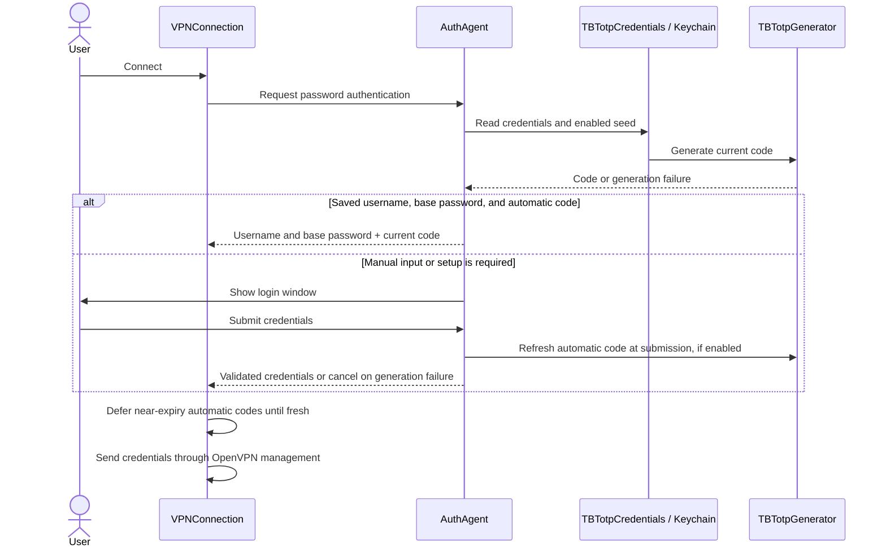

# Automatic TOTP: implementation notes

This document describes the proposed optional TOTP extension for Tunnelblick's 8.x branch. Start with the [user guide](SETUP.md) for configuration.

## Scope

The supported login format is a saved base password followed directly by a six-digit TOTP code. The application uses HMAC-SHA1 and a 30-second time step. QR import extracts the provisioning seed once; it is not used to recognize an image on each connection.

The importer accepts Base32 text and extracts the `secret` query parameter from an `otpauth` URI. It does not retain `algorithm`, `digits`, `period`, issuer, or account-label parameters. Although the low-level parser also accepts an `otpauth://hotp` host, the connection code always generates TOTP; HOTP accounts are not supported. Authenticator transfer payloads using `otpauth-migration://` are not supported.

## Modules

- `TBTotpGenerator.h/.m`: Base32 validation and decoding, provisioning-URI secret extraction, and RFC 6238 generation using CommonCrypto. The timestamp-taking method supports deterministic tests.
- `TBTotpSecretImporter.h/.m`: text import and local QR decoding using Vision's `VNDetectBarcodesRequest`.
- `TBTotpCredentials.h/.m`: credentials-group resolution, Keychain storage, preferences, and the six-digit/30-second generation entry point.
- `TBTotpTiming.h`: shared timing constants and fresh-code/retry calculations.
- `AuthAgent.h/.m`: saved-credential login, code generation at submission, and tracking whether automatic TOTP was used.
- `VPNConnection.h/.m`: deferred credential delivery, bounded authentication retries, reconnect state, and cancellation.
- `LoginWindowController.m`: prefilled security codes and the setup/clear shortcuts in the login window.
- `SettingsSheetWindowController.m`: the **VPN Credentials** panel's programmatically created TOTP controls.

The TOTP source files are part of the `Tunnelblick` Xcode target. QR decoding uses Vision; generation uses CommonCrypto without an external OTP service.

## Authentication flow

The login window is skipped only when the required saved credentials and an automatic code are available. Private-key passphrases, static challenges, CRV1 challenges, and manual security codes keep their existing handling.

`AuthAgent` assembles the submitted password by appending the selected security token to the base password. The code is refreshed when an open login window is submitted, so a prefilled token cannot simply age while the user edits other fields. Automatic generation failure at that point cancels submission.

## Secret storage

`credentialsNameForDisplayName:` uses the global named credentials group when configured, then the profile's named credentials group, then the profile display name. The Keychain service is `Tunnelblick-Auth-Group-{name}` for a named group, or `Tunnelblick-Auth-{displayName}` for a profile without a group. The Keychain account name is `totpSecret`.

The stored seed is normalized to uppercase with spaces removed. It is a separate Keychain item from the username and password. The settings panel displays a masked secure text field after saving; this extension provides no seed export UI.

Preferences contain state, not the seed:

- `{credentialsName}-totpAutoFillEnabled`: automatic generation is enabled.
- `{credentialsName}-keychainHasTotpSecret`: the seed is expected to exist in Keychain.
- `{displayName}-loginWindowSecurityTokenCheckboxIsChecked`: the existing security-token option.

The new preference suffixes are registered in `defines.h`. Saving a seed updates the flags and enables security-token use. If a flagged Keychain seed is missing, the stale presence flag is removed. Clearing a seed removes its Keychain item and TOTP flags. Turning automatic generation off keeps the seed. The existing `AuthAgent` path that deletes credentials including the username also clears the TOTP seed.

Profiles sharing a credentials group share a seed. Group changes therefore affect which seed is read; do not treat the storage as unconditionally per-profile.

## Fresh-code timing and automatic retries

`TBTotpTiming.h` defines:

- `TBTotpPeriod = 30` seconds.
- `TBTotpMinimumValidity = 5` seconds.
- `TBTotpMaximumRetries = 2` additional attempts after the initial authentication.

Automatic credential delivery is deferred when the current code has five seconds or less remaining. After an automatic TOTP authentication failure, the next eligible attempt is at least one second later and no earlier than one second into the time step after the rejected code. This avoids resending the rejected time step, including when the system clock moves backward.

The connection owns the deferred-credential timer. Disconnect and connection reinitialization cancel it; stale callbacks cannot reconnect on their own. The retry budget survives the OpenVPN process restart used by the retry path and resets after success or a new user-initiated connection.

Only a failure associated with actual automatic TOTP use takes this path. Saved credentials are retained. After two retries, the connection stops, adds a log entry, and attempts a system notification instead of presenting the saved-password choice dialog.

## Interface and localization

The main configuration entry is **Configurations → Advanced… → VPN Credentials**. `setupTotpCredentialsUI` creates the enable checkbox, text input, masked stored-seed field, save/import/clear buttons, and seed-storage notice. `refreshTotpCredentialsUI` updates the controls for the selected profile and credentials group.

`LoginWindowController` adds the **Configure automatic security code…** shortcut and a clear action.

User-facing strings use `NSLocalizedString` with English source keys. This implementation does not add translations; localization follows the upstream Crowdin workflow. Developer comments and documentation use English.

## Verification

Run `python3 tests/run-tests.py` on macOS. It compiles the production generator and selected authentication methods with in-memory doubles for OS and connection interactions. It does not read real Keychain entries or contact a VPN server.

Coverage includes RFC 6238 vectors, leading zeros, expiry boundaries, fresh-code waiting, retry limits, duplicate events, reconnect state, cancellation, manual authentication, static/CRV1 challenge isolation, skipping the saved-credential login window, refreshing a token at submission, respecting the token checkbox, and cancelling submission when generation fails.

These tests do not replace manual verification of QR import, actual Keychain storage, UI layout, or compatibility with a particular VPN server. Build this branch using the upstream [build instructions](../Building%20Tunnelblick%20from%20Source%20Code.markdown) before performing those checks.

## Operational limits

A correct seed does not make an unsupported server flow compatible. Importing a URI with non-default OTP parameters does not change the connection's fixed settings. The retry limit cannot recover from revoked seeds, account restrictions, or incorrect passwords.

The TOTP component computes codes locally and uses no remote decoding service. Passwords and generated codes are still submitted to the configured VPN server. Storing the seed and password on the same Mac changes factor separation; deployment should follow the account administrator's policy.
